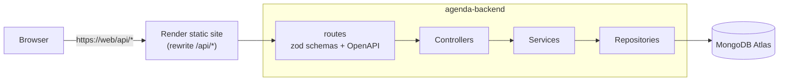

# agenda-backend

[](https://github.com/andreagil5647/agenda-backend/actions/workflows/ci.yml)

REST API for **Agenda**, a calendar and task planner built around time-blocking: tasks and
events live on the same timeline, and you plan a day by dragging tasks into time slots.

The web app lives in [andreagil5647/agenda](https://github.com/andreagil5647/agenda).

> **Status:** the API behind the day planner. Cookie sessions, a one-click demo that opens on
> a seeded day, calendars, tasks with manual ordering, and one-off timed and all-day events
> are in place, with optimistic concurrency on every change, and are covered by unit and
> integration tests. Recurring events, reminders and push notifications come next - see the
> [roadmap](docs/ROADMAP.md).

## Stack

| Concern    | Choice                                                        |
| ---------- | ------------------------------------------------------------- |
| Runtime    | Node.js 22, TypeScript 6 (strict, ESM)                        |
| HTTP       | Express 5, helmet, cors, express-rate-limit                   |
| Validation | zod 4, shared with the OpenAPI document                       |
| API docs   | OpenAPI 3.1 generated from the routes, served with Swagger UI |
| Database   | MongoDB Atlas (free tier) with the official driver            |
| Logging    | pino (JSON in production), one line per request with an id    |
| Tests      | Vitest, Supertest, mongodb-memory-server (a real `mongod`)    |
| Hosting    | Render web service, behind the web app's same-origin `/api/*` |

## Architecture



- **routes** declare each endpoint once with `createRouteBuilder`: the same zod schemas
  validate the request and describe it in the OpenAPI document.
- **controllers** translate HTTP into service calls and choose status codes.
- **services** hold the use cases and know nothing about HTTP.
- **repositories** are the only layer that talks to MongoDB, and return documents.
- **mappers** turn a document into the shape the API sends, one per resource.
- **domain** holds pure logic with no Express or MongoDB imports, so it can be unit-tested on
  its own: task ordering keys, time zone conversion, the rules for an event's schedule, and the
  day a demo account starts with.

Each resource (`me`, `calendars`, `tasks`, `events`, `demo`) is a vertical slice with its own
routes, controller, service, schemas and mapper.

Every error response has the same shape, and clients branch on `code`:

```json
{ "code": "NOT_FOUND", "message": "Route GET /api/v1/nope not found", "requestId": "…" }
```

The `message` is English, for logs. Where one code covers several situations a person should
hear about differently (a `409` can be a taken email, a `429` a full demo), `details.reason`
says which, from a fixed list in the contract. A client translates from `code` and `reason`.

Calendars, tasks and events carry a `version`, sent as an `ETag`. Changing or deleting one
requires `If-Match` with the version the change is based on: a stale version answers `412`
and a missing header `428`, so an old tab cannot overwrite a newer edit
([ADR 0006](docs/adr/0006-optimistic-concurrency-with-version-etags.md)).

```bash
curl -X PATCH /api/v1/tasks/$ID -H 'If-Match: "3"' -d '{"status":"done"}'   # 200, ETag: "4"
curl -X PATCH /api/v1/tasks/$ID -H 'If-Match: "3"' -d '{"title":"Again"}'   # 412
```

## API at a glance

Everything is under `/api/v1`, and the full contract is browsable at `/api/docs`. Apart from
the health checks and signing in, a call needs the session cookie, and a call that changes
something also needs the CSRF token in a header
([ADR 0007](docs/adr/0007-cookie-sessions-and-csrf.md)).

| Resource  | Endpoints                                                                                                |
| --------- | -------------------------------------------------------------------------------------------------------- |
| Auth      | `POST /auth/register`, `/auth/login`, `/auth/logout`, `/auth/demo`; `GET /auth/session`                  |
| Me        | `GET`, `DELETE /me`; `PATCH /me/settings`                                                                |
| Calendars | `GET`, `POST /calendars`; `PATCH`, `DELETE /calendars/:id`; `PUT /calendars/order`                       |
| Tasks     | `GET`, `POST /tasks`; `PATCH`, `DELETE /tasks/:id`; `POST /tasks/:id/restore`; `PUT /tasks/:id/position` |
| Events    | `GET /events?from&to`; `POST /events`; `PATCH`, `DELETE /events/:id`                                     |

`PATCH`, `DELETE` and `PUT /tasks/:id/position` need `If-Match`, as above. A `PATCH` changes only
the fields it sends: a field left out keeps its stored value.

`POST /auth/demo` creates a throwaway account that is deleted after a day and opens it on a
full, seeded day in the visitor's time zone, written in the language they ask for (`locale`,
English or Spanish). It has its own, stricter rate limit, and the number of demo accounts alive
at once is capped.

An account's language (`settings.locale`) is one of the same two. It can be sent when signing up,
and changed in `PATCH /me/settings`; the API refuses any other value.

## Time zones

Every account has an IANA time zone, taken from the browser at sign-up. A timed event stores
instants and the zone it was made in. An all-day event stores plain dates and no zone, because
"the 12th" is the 12th wherever you are.

`GET /events?from&to` takes two instants and returns what overlaps them. An all-day event matches
the dates those instants fall on in the account's zone, not in UTC, so a day looks the same to
the user whatever the server's clock says. The conversions use `Intl` behind `src/domain/time`
([ADR 0009](docs/adr/0009-time-zone-conversion-with-intl.md)) and are tested with zones on both
sides of UTC, across daylight saving changes, and at half-hour offsets.

## Project layout

```text
src/
  app.ts            builds the Express app from its dependencies (used by tests)
  server.ts         entry point: config, database, HTTP server, graceful shutdown
  config/           environment validation and logger
  routes/           endpoint declarations, one file per resource
  controllers/      HTTP adapters, one file per resource
  services/         use cases, one file per resource
  mappers/          document-to-response mapping, one file per resource
  repositories/     MongoDB queries, one file per collection
  domain/           framework-free logic with unit tests:
                      task-order/ time/ events/ demo/
  schemas/          zod schemas shared by validation and docs
  middleware/       sessions and CSRF, error handling, request logging, rate limiting
  http/             cookies and ETags
  openapi/          route builder and document generation
  errors/           AppError and its subclasses
  db/               MongoDB connection and indexes
scripts/            generate-openapi.ts: writes and checks the contract
test/
  integration/      HTTP tests against a real mongod
  helpers/ setup/   test config, per-file databases, a signed-in API session, global mongod
openapi/openapi.json  generated contract, committed; the web app builds its types from it
```

## Getting started

Requirements: Node.js 22.13 or later, and a MongoDB connection string (a free
[Atlas](https://www.mongodb.com/atlas) cluster works).

```bash
npm ci
cp .env.example .env      # then set MONGODB_URI
npm run dev               # http://localhost:4000
```

- Liveness: <http://localhost:4000/api/v1/health>
- Readiness (pings the database): <http://localhost:4000/api/v1/health/ready>
- API docs: <http://localhost:4000/api/docs>

## Scripts

| Script                     | What it does                                         |
| -------------------------- | ---------------------------------------------------- |
| `npm run dev`              | Start with reload on change (`tsx watch`)            |
| `npm run build` / `start`  | Compile to `dist/` / run the compiled server         |
| `npm test`                 | Unit and integration tests                           |
| `npm run test:coverage`    | Tests with a coverage report in `coverage/`          |
| `npm run lint` / `format`  | ESLint (type-aware) / Prettier                       |
| `npm run typecheck`        | `tsc --noEmit`                                       |
| `npm run openapi:generate` | Rewrite `openapi/openapi.json` from the routes       |
| `npm run openapi:check`    | Fail if the committed contract is stale (runs in CI) |

## Testing

- **Unit tests** sit next to the code (`src/**/*.test.ts`) and need no database.
- **Integration tests** (`test/integration`) call the app through Supertest against a real
  `mongod` started once per run by mongodb-memory-server. Each test file gets its own
  database. The first run downloads the `mongod` binary.
- The integration tests cover the unhappy paths of the main flows: invalid input, no session, no
  CSRF token, another user's resource, a stale version and a missing document. Calendar
  reorder, calendar deletion and account deletion do not have their own tests yet; the
  [roadmap](docs/ROADMAP.md) lists them.
- Tests that involve dates run in zones on both sides of UTC, since a test that only runs in
  UTC cannot see a time zone bug
  ([debugging note 0004](docs/debugging/0004-all-day-event-on-the-wrong-day.md)).

## Deployment

`render.yaml` describes the service: a free web service in Frankfurt, deployed from `main`
after CI passes, with `/api/v1/health` as the health check.

In production the browser never calls this service directly. The web app's static site
rewrites `/api/*` to it, so the API shares the web app's origin and session cookies are
first-party (see [ADR 0003](docs/adr/0003-same-origin-api-through-render-rewrite.md)).

| Variable                | Required | Default                 | Notes                            |
| ----------------------- | -------- | ----------------------- | -------------------------------- |
| `MONGODB_URI`           | yes      |                         | `mongodb://` or `mongodb+srv://` |
| `MONGODB_DB_NAME`       |          | `agenda`                |                                  |
| `PORT`                  |          | `4000`                  | Set by Render                    |
| `CORS_ORIGINS`          |          | `http://localhost:3000` | Comma-separated origins          |
| `TRUST_PROXY_HOPS`      |          | `1`                     | Proxies in front of the app      |
| `RATE_LIMIT_WINDOW_MS`  |          | `900000`                |                                  |
| `RATE_LIMIT_MAX`        |          | `600`                   | Requests per window per IP       |
| `DEMO_RATE_LIMIT_MAX`   |          | `20`                    | Demo sign-ins per window per IP  |
| `DEMO_MAX_ACTIVE_USERS` |          | `200`                   | Demo accounts alive at once      |
| `LOG_LEVEL`             |          | `info`                  | pino level                       |

Invalid configuration stops the process at startup with a message that names each variable
without printing its value.

## Conventions

- Branches: `main` (deployed) ← `develop` (integration) ← `feat/*`, `fix/*`, `refactor/*`,
  `test/*`, `chore/*`, `docs/*`. See [CONTRIBUTING.md](CONTRIBUTING.md).
- Commits follow [Conventional Commits](https://www.conventionalcommits.org/), enforced by
  commitlint in a Git hook and in CI.

## Documentation

- [Roadmap](docs/ROADMAP.md): domain model, target API surface and build order.
- [Architecture decision records](docs/adr/README.md)
- [Debugging notes](docs/debugging/README.md): bugs found during development, with the
  investigation and the regression test that now guards each one.

## License

[MIT](LICENSE)
